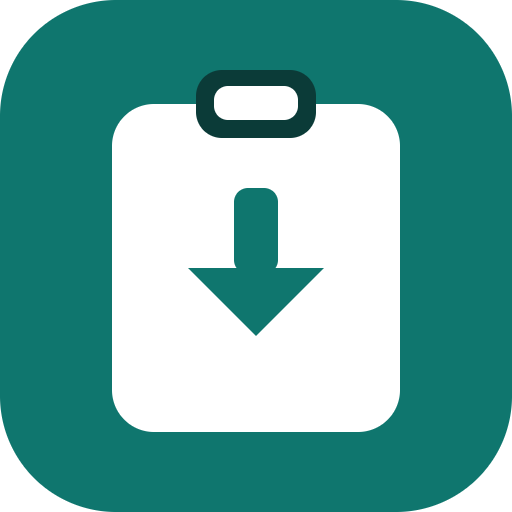
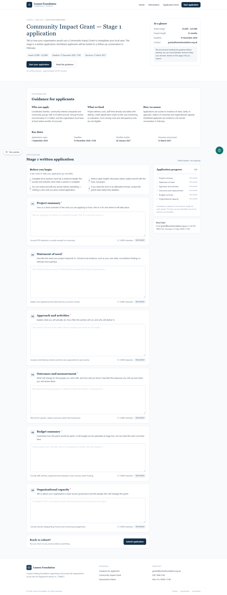
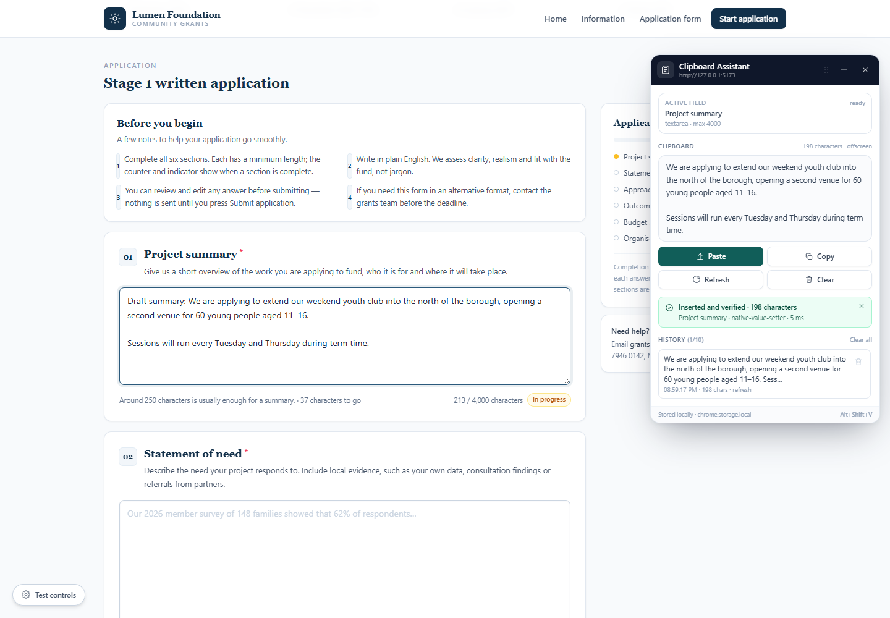
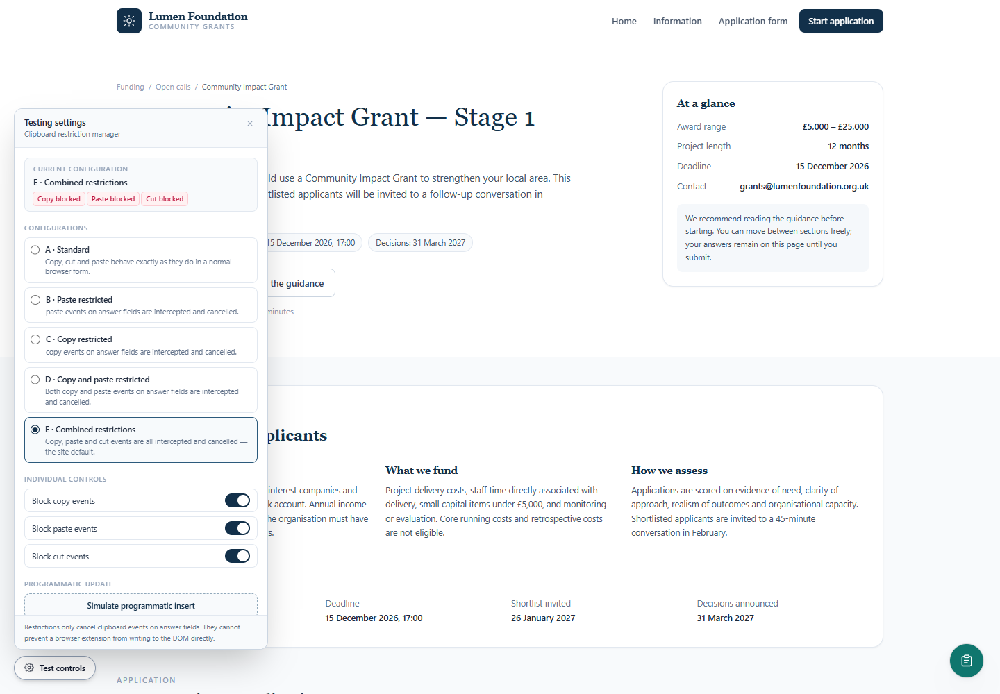
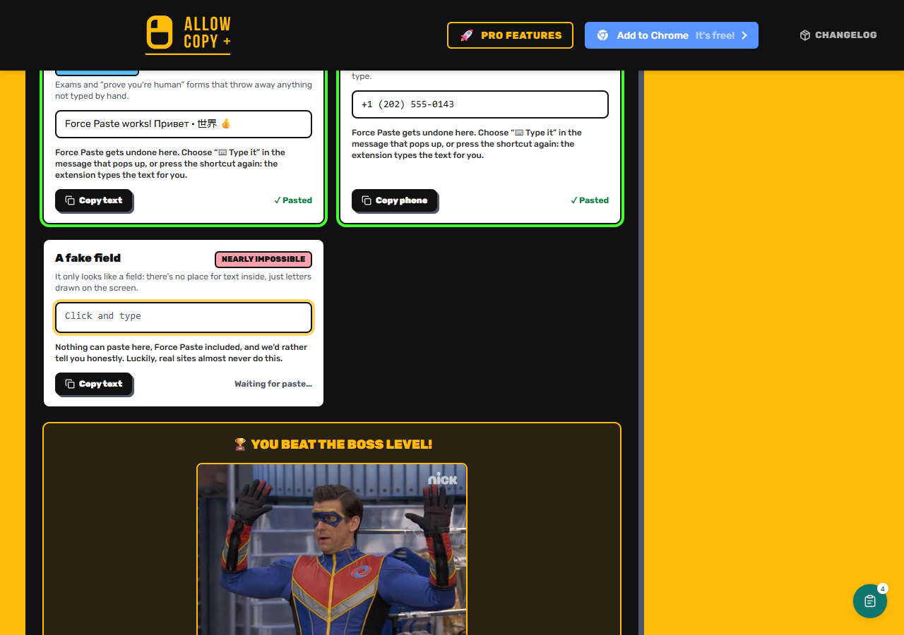
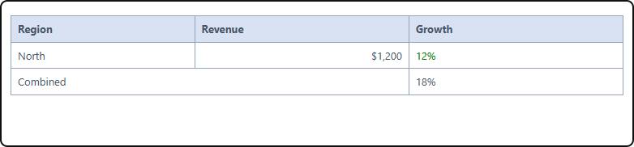

<p align="center">
  
</p>

<h1 align="center">Clipboard Assistant</h1>

<p align="center">Paste into any field, even where paste is blocked.</p>

A free **Chrome and Microsoft Edge extension** that puts the text you copied into form fields that
block, cancel or reject paste. It also keeps a short clipboard history, refreshes itself
automatically, and can type your text into forms that only accept real keystrokes.

No account, no cloud, no analytics. Everything stays on your computer.

[](#install)
[](#install)
[](#technical-details)
[](https://github.com/Lionelapex/clipboard-assistant/releases)
[](LICENSE)
[](#privacy)
[](https://github.com/Lionelapex/clipboard-assistant/actions/workflows/tests.yml)

**Contents**

- [Part 1: For everyone](#part-1-for-everyone)
  - [What this extension does](#what-this-extension-does)
  - [What you can do with it](#what-you-can-do-with-it)
  - [Install](#install)
  - [How to use it](#how-to-use-it)
  - [It updates itself](#it-updates-itself)
  - [Formatting and size](#formatting-and-size)
  - [Tables from Word](#tables-from-word)
  - [When a site only accepts typing](#when-a-site-only-accepts-typing)
  - [Your clipboard history](#your-clipboard-history)
  - [Privacy](#privacy)
  - [Questions people ask](#questions-people-ask)
  - [What it cannot do](#what-it-cannot-do)
- [Part 2: For developers](#part-2-for-developers)
  - [Technical details](#technical-details)
  - [Repository layout](#repository-layout)
  - [Build, load and test](#build-load-and-test)
  - [Test coverage](#test-coverage)
  - [How insertion works](#how-insertion-works)
  - [Automatic refresh](#automatic-refresh)
  - [Continuous integration](#continuous-integration)
  - [Permissions](#permissions)
  - [Compatibility at a glance](#compatibility-at-a-glance)
  - [Keyboard shortcuts](#keyboard-shortcuts)
  - [Known limitations](#known-limitations)
  - [Troubleshooting](#troubleshooting)
  - [Screenshots](#screenshots)
  - [The mock website](#the-mock-website)
  - [Contributing and license](#contributing-and-license)

---

# Part 1: For everyone

## What this extension does

Some websites stop you from pasting. You copy something (a password, an email address, a paragraph you
already wrote somewhere else) and the field refuses it. Sometimes `Ctrl+V` does nothing. Sometimes the
text appears for a split second and then disappears. Some forms even insist that you type every
character by hand.

**Clipboard Assistant gets your text into that field anyway.**

You click the field, open the assistant, and press **Paste**. The text appears, paragraph breaks and
all, and the extension checks that it really arrived instead of just saying "done".

It is a clipboard manager and paste assistant for Chrome and Edge. It works on ordinary web forms,
writing boxes, code editors and embedded widgets, on any website you can open.

## What you can do with it

- **Fill in application forms** without retyping your address, reference number or personal statement.
- **Paste into "confirm your email" and password boxes** that try to force manual typing.
- **Move long text between writing tools.** Drafts, essay answers and support messages all arrive even
  when the destination refuses the clipboard.
- **Paste into code editors** and rich text boxes that normally swallow pasted content.
- **Reuse something you copied earlier** from the last ten snippets, without finding the source again.
- **Paste into embedded widgets** (the small boxes inside a page) when they belong to the same site.

People find this kind of tool by searching for an extension to paste on sites that block copy and
paste, a Chrome extension for a paste-disabled field, a way to force paste into an exam answer box, or
simply a clipboard manager for Chrome and Edge.

## Install

The extension is not in the Chrome Web Store, so you install it yourself. It takes about a minute:

1. Open the [latest release](https://github.com/Lionelapex/clipboard-assistant/releases) and download
   **`clipboard-assistant-1.6.0.zip`**.
2. **Unzip it.** You should see `manifest.json` inside the folder.
3. Open `chrome://extensions` (or `edge://extensions` in Edge) and turn on **Developer mode**.
4. Click **Load unpacked** and choose the unzipped folder.

The Clipboard Assistant icon appears in your toolbar. Pin it for one-click access.

> Works on Chrome or Edge 116 and newer. After installing, reload any tab that was already open.

## How to use it

**The quick way**

1. Copy the text you need, from another site, an app or a document.
2. Click into the field you want to fill. The assistant remembers that field, so you do not have to
   keep it selected while you open the popup.
3. Open the assistant: click its toolbar icon, or press `Alt+Shift+V` for the floating panel.
4. Press **Paste**. The text goes in, and the assistant confirms the field it used and how many
   characters it inserted.

**The floating panel**

A small round bubble sits at the bottom right of every page. Click it (or press `Alt+Shift+V`) to open
a panel you can drag anywhere. It shows the clipboard, the last ten copies, and the same Paste, Copy,
Refresh and Clear buttons. It is handy when you are filling several fields in a row.

**If it says "No field selected"**, click into the text field first. The assistant never guesses: it
always uses the field you last clicked.

## It updates itself

You do not have to press **Refresh**. While the panel or popup is open, the assistant watches your
clipboard and picks up a new copy within a second or two. Copy something in another app, look back at
the panel, and it is already there. Refresh is still available if you want to force a re-read.

## Formatting and size

There is no character or word limit in Clipboard Assistant. A short email address and a 50,000
character report take the same path, and the test suite includes a 50,000 character round trip. The
only ceiling is the destination itself: if a form sets `maxlength="500"`, that form keeps 500
characters, because its own rule outranks anything an extension does.

Formatting is kept when the destination can hold it. Copy a heading, some bold words and a bulleted
list, then paste into a rich text editor or a word-processor style box: the heading, bold text and
list arrive with their structure. Plain fields (a normal input or textarea) cannot display bold, so
they receive the same words as clean text.

Pasted markup is cleaned before it reaches the page. Scripts, event handlers and `javascript:` links
are removed, so a copied web page cannot inject code through the assistant.

## Tables from Word

A table copied from Word, Excel or a web page arrives as a real table in a rich text editor: the
same rows and columns, merged cells, header shading, column proportions, alignment and borders. Word
hides most of that in private markup, so the assistant translates the safe parts into plain table
markup that every editor understands.

In a plain textarea or input, where a table cannot exist, the same content is pasted as
tab-separated rows. One line per row and one tab per column means the data keeps its shape, and it
drops into a spreadsheet as separate cells instead of one long line.

Borderless tables stay borderless, and a borderless cell inside a bordered table, such as the narrow
spacer column in a two-part answer grid, stays open. Wide tables are capped at the width of the field
so they cannot push a page sideways.

## When a site only accepts typing

Some forms throw away anything that was not typed by hand. They undo a pasted block instantly because
they only accept one character at a time.

For those fields the assistant has **Type it**. Instead of dropping the whole block in at once, it
types your text one character at a time, the way a keyboard would, and then checks the result.

Press **Paste** first. If the field undoes it, the assistant retries automatically by typing. You can
also press **Type it** directly in the panel or popup.

## Your clipboard history

The last **ten** things you copied are kept on your own computer, newest first, each with a timestamp
and a size. Click one to reuse it, delete one you do not need, or clear the whole list.

Only copies the assistant actually saw are recorded, and anything a website blocks is not recorded.

## Privacy

- Everything is stored locally with `chrome.storage.local`.
- No account, no server, no API key, no analytics and no telemetry.
- Clipboard text never leaves your computer.
- The clipboard is read only while the panel or popup is open (plus when you copy on a page), and it
  is written only when you press **Copy** or **Clear**.

## Questions people ask

**Is it free?** Yes. There is no paid tier and nothing to sign up for.

**Does it work on every website?** It works on every normal `http` and `https` page that Chrome lets an
extension run on. Browser settings pages, the extension store and the built-in PDF viewer are blocked
by the browser itself.

**Can it paste into password boxes?** Yes. A password field accepts pasted text the same way it
accepts typing. The assistant does not go looking for passwords, and its history only holds copies you
actually make.

**Why does a field still reject the text?** A few "fields" are not fields at all. They draw letters on
screen and keep no real value. Nothing can be inserted into those, and the assistant tells you so
instead of pretending.

**Chrome or Edge?** Both. It is the same build, and Edge runs Chrome extensions directly.

## What it cannot do

- **Fill "fake" fields.** A box that only paints characters and keeps no text value cannot be filled by
  any extension. You get a clear message instead of a silent failure.
- **Reach into another website's embedded frame.** Widgets served from a different domain are isolated
  by the browser. Same-site widgets work.
- **Defeat a browser policy.** If your organisation blocks clipboard access or extensions, the
  assistant reports the block instead of trying to get around security settings.
- **Read text that is an image.** If the words are part of a picture, there is no text to copy.

---

# Part 2: For developers

## Technical details

Clipboard Assistant is a Manifest V3 extension (React 18, TypeScript, Vite, Tailwind) with a service
worker, a content script that mounts a shadow-DOM panel on every page, an offscreen document for
clipboard access, and a toolbar popup. Insertion is verified by reading the field back, so a success
message is never shown unless the value really changed.

| Piece | Stack or behaviour |
| --- | --- |
| Extension | React 18, TypeScript, Vite, Tailwind CSS, Manifest V3 |
| Clipboard reads | Offscreen document (`execCommand('paste')`) first, capturing plain text and HTML in separate passes; `navigator.clipboard.read()` is a timed fallback |
| Panel | Shadow DOM, so Tailwind cannot leak into or out of the host page; draggable, position persisted |
| Insertion | Native prototype value setter plus a synthetic `input`; sanitised `insertHTML` for rich editors; `execCommand('insertText')` for plain text; character-by-character typing for paste-hostile fields |
| Verification | Read-back comparison, whitespace normalised, with an alphanumeric fallback for masked inputs |
| Focus tracking | Last-focused field (not `document.activeElement`), shadow-DOM aware and same-origin frame aware |
| Storage | `chrome.storage.local`: history capped at 10 with text and HTML, current snippet, panel state, clipboard fingerprint |
| Tests | Playwright against the installed Chrome (no downloaded browser): 57 deterministic tests plus 2 opt-in live checks |
| Test site | A local "Lumen Foundation" grant application with configurable copy, paste and cut restrictions (A to E) |

## Repository layout

```
clipboard-assistant-project/
  extension/            Manifest V3 extension (React + TS)
    public/manifest.json
    src/
      background/       service worker: messages, offscreen lifecycle, shortcuts
      content/          shadow-DOM panel, focus tracking, message bridge
      popup/            toolbar popup
      insertion/        insertion strategies, typing, verification, frame bridge
      clipboard/        clipboard read/write, copy-event capture
      storage/          history, current snippet, settings, clipboard fingerprint
      components/       shared panel and popup UI
  mock-website/         "Lumen Foundation" grant form and restriction test controls
  integration/          Playwright suite, fixtures, scripts
  branding/             logo, social preview, icon source
  docs/COMPATIBILITY.md Full compatibility matrix and failure classification
```

## Build, load and test

```bash
# 1. Extension
cd extension
npm install
npm run build          # tsc plus two Vite passes, output in extension/dist

# 2. Load it
#    chrome://extensions -> Developer mode -> Load unpacked -> extension/dist

# 3. Local test site
cd ../mock-website
npm install
npm run dev            # http://localhost:5173

# 4. Test suite (the extension must be built first)
cd ../integration
npm install
npx playwright test

# 5. Opt-in live checks against the public playground
ALLCOPY_LIVE=1 npx playwright test tests/allowcopyplus-live.spec.ts tests/allowcopy-live.spec.ts
```

**Why CDP instead of `--load-extension`?** Chrome 137 removed that switch, so the suite installs the
unpacked build through the CDP command `Extensions.loadUnpacked`. It uses the Chrome already on the
machine, so no Playwright browser is downloaded.

## Test coverage

`tests/mock-site.spec.ts` (7 tests): restriction matrix A to E, typing, backspace, arrows, selection and
paragraphs, counters, event log, programmatic changes bypassing clipboard events, submit validation.

`tests/extension.spec.ts` (12 tests): install and popup render; clipboard, preview and verified paste
into the active field; field switching; caret insertion; input, textarea, contenteditable and a 9,000
character snippet; panel drag, minimise and restore; history cap at 10; no-field error; popup Paste into
the last-focused field; popup Copy and Clear.

`tests/universal.spec.ts` (5 tests): plain HTML, React 18 and dynamically created fields on an origin
that appears nowhere in the extension source; two sites in one session; removed-field diagnostic.

`tests/compatibility.spec.ts` (15 tests): Vue 3 `v-model` and dynamic fields, `maxlength`, Unicode and
paragraphs, read-only, disabled and number inputs, `plaintext-only`, multiple fields, open shadow DOM,
same-origin iframe, cancelled paste, `Ctrl+V` keyboard trap, blocked copy with the capture shortcut,
the shortcut insert flow and the empty-storage diagnostic.

`tests/typing.spec.ts` (5 tests): a bulk paste reverted by a two-character guard and retyped
automatically, the explicit **Type it** button, a keydown-driven masked phone field, a fake
`div[role=textbox]` refused honestly, and a same-origin iframe field.

`tests/auto-refresh.spec.ts` (4 tests): first copy after opening, second copy while open, popup parity,
and a captured selection surviving a stale clipboard read.

`tests/rich-text.spec.ts` (4 tests): formatted clipboard content keeps its heading, bold text and list
in a rich editor; script tags and event handlers are stripped before insertion; a 50,000 character
paste arrives complete; and the capture shortcut stores formatted selection markup.

`tests/tables.spec.ts` (5 tests): a Word-shaped table keeps its rows, header shading, colspan,
proportions and alignment in a rich editor; the same table becomes tab-separated rows in a textarea;
a borderless table stays borderless; a borderless spacer cell stays open inside a bordered table; and
the capture shortcut keeps a selected table.

`tests/allowcopy-live.spec.ts` and `tests/allowcopyplus-live.spec.ts` (opt-in): real sites. Content
injection and capture on allowcopy.com, and every editable control on the Allow Copy + playground,
including its Boss level (typing-only, masked phone, fake field) and embedded iframe widget.

The full matrix, mechanisms and failure classification live in
[`docs/COMPATIBILITY.md`](docs/COMPATIBILITY.md).

## How insertion works

1. **Resolve the target.** The last-focused editable element is tracked from `focusin` and
   `pointerdown`, descending open shadow roots and same-origin frames. The popup never guesses the
   first field.
2. **Paste.** For `input` and `textarea`, the native prototype value setter bypasses React's patched
   setter so the framework's value tracker notices the change, and a synthetic `input` event follows.
   For contenteditable, the clipboard's HTML is sanitised (allowlisted tags only; scripts, event
   handlers, images and `javascript:` links are removed) and inserted with `execCommand('insertHTML')`,
   so headings, bold text, links and lists keep their structure. Plain text uses
   `execCommand('insertText')` in the element's own document, with a Range fallback that preserves
   paragraph breaks.
3. **Verify.** The field is read back and compared with the intended text. Truncation, read-only,
   disabled, removed and unsupported fields each get their own reason.
4. **Retry by typing.** If the field reverted the value to exactly what it was before, the text is
   re-inserted one code point at a time: a cancelable `keydown` first (so masked inputs can call
   `preventDefault()` and own the character), then `execCommand('insertText')`, yielding every 16
   characters. This is what fills "typing only" fields.
5. **Frames.** Fields inside same-origin iframes are tracked by attaching focus listeners to the frame
   document. Cross-origin frames are reported as unreachable rather than guessed at.

## Automatic refresh

The panel polls the clipboard every 1.6 seconds while open (the popup uses 1.2 seconds) and adopts a
value as soon as it differs from the last one it saw. A `clipboardSeen` fingerprint in
`chrome.storage.local` stops a stale clipboard read from overwriting a snippet captured with
`Alt+Shift+C`, which deliberately does not touch the system clipboard. Adoption re-checks the stored
snippet immediately before writing, so a capture or history selection that lands mid-read always wins.

## Continuous integration

`.github/workflows/tests.yml` runs on every push and pull request. It installs the three packages,
builds the extension, and runs the 57 deterministic Playwright tests on a Windows runner using the
Chrome that is already installed there. The two live checks stay opt-in because they depend on public
websites.

## Permissions

| Permission | Why |
| --- | --- |
| `storage` | history, current snippet, panel state, clipboard fingerprint |
| `unlimitedStorage` | keeps large clipboard entries and history clear of the default storage quota |
| `clipboardRead`, `clipboardWrite` | read the clipboard on request; Copy and Clear |
| `offscreen` | DOM-based clipboard access without a per-site permission prompt |
| `scripting` | inject the content script into tabs that were open before install |
| `<all_urls>` | the assistant works on any normal page, with no application-level allowlist |

Chrome still protects its own surfaces. `chrome://`, `edge://`, the Web Store and the PDF viewer cannot
be scripted, and `file://` pages need "Allow access to file URLs". Those cases produce a specific
technical message, never a fake allowlist error.

## Compatibility at a glance

| Scenario | Result |
| --- | --- |
| `input`, `textarea`, `contenteditable`, `plaintext-only` | pass |
| React 18 controlled fields, Vue 3 `v-model`, dynamic fields | pass, with state and counters updated |
| `maxlength`, Unicode, emoji, paragraphs, caret position | pass, read-back verified |
| Rich text (heading, bold, italic, links, lists) into a contenteditable editor | pass, structure kept |
| Word table (merged cells, header shading, borders, column widths) into a rich editor | pass, table kept |
| Table into a textarea or input | pass as tab-separated rows, because the field cannot hold a table |
| 50,000 character paste into a textarea | pass, nothing truncated by the extension |
| Read-only, disabled, `type="number"`, removed field | refused with a specific reason |
| Shadow DOM (web components) | pass |
| Same-origin iframe or embedded widget | pass |
| Cross-origin iframe | not supported (browser isolation) |
| Page cancels paste, traps `Ctrl+V`, or blocks copy | extension insertion still works |
| "Typing only" field that reverts bulk changes | pass, automatic retype |
| Masked phone-style field driven by `keydown` | pass, typed and mask verified |
| Fake field that draws letters and keeps no value | not possible, reported honestly |

## Keyboard shortcuts

| Shortcut | Action |
| --- | --- |
| `Alt+Shift+V` | Open or close the floating panel |
| `Alt+Shift+C` | Capture the current selection into the assistant, including where copy is blocked |
| `Alt+Shift+P` | Insert the stored snippet into the last-focused field |

Rebind them at `chrome://extensions/shortcuts` (Edge: `edge://extensions/shortcuts`).

## Known limitations

- **Typing is simulated.** Characters are sent as a cancelable `keydown` plus the browser's own insert
  command. A field that demands trusted key events (not just a trusted edit) would need the `debugger`
  API, which brings a visible debugging banner and is deliberately not used.
- **Plain fields cannot show formatting.** An `input` or `textarea` stores text only, so headings and
  bold arrive as plain words, and a table arrives as tab-separated rows. Rich structure needs a
  contenteditable or rich text editor.
- **A form's own `maxlength` still applies.** The extension does not bypass a destination's validation
  rule, and a field that wants 500 characters will keep 500.
- **Very large text in a typing-only field is slow.** Typing is character by character by definition;
  a 50,000 character paste into a field that rejects bulk edits takes a long time.
- **Cross-origin frames** are unreachable by design.
- **Fake fields** (a `div` that paints text with no value) cannot be filled by any extension.
- **Canvas-based editors** fall back to DOM insertion, and verification reports what actually happened.
- **Polling, not events.** Automatic refresh has 1.2 to 1.6 seconds of latency while the assistant is
  visible, and it does not read the clipboard when the assistant is closed.
- **Chromium only.** `chrome.offscreen` and MV3 service workers are used, so Firefox is not targeted.
- **No store signing.** The extension is loaded unpacked, so Chrome shows the usual Developer mode
  reminder at startup. Store distribution would need a developer account.
- **Panel position is global**, not per-site or per-tab.
- **The mock website is not a real funder.** The "Lumen Foundation" form is a local test environment.

## Troubleshooting

| Symptom | Fix |
| --- | --- |
| "Manifest file is missing or unreadable" | You selected the source `extension` folder. Load **`extension/dist`**, or the unzipped release folder that contains `manifest.json`. |
| No floating panel | Click the round bubble at the bottom right, or press `Alt+Shift+V`. Reload tabs that were open before install. |
| "Clipboard could not be read" | Click the page once so it has focus. The assistant refreshes itself while open, and **Refresh** retries on demand. |
| "No field selected" | Click into the text field first. The assistant targets the last field you focused. |
| "That field is read-only" or "disabled" | The page itself prevents edits, so choose another field. |
| "Insertion could not be verified" | The site reverted the change. Try **Type it**. If that fails too, it is not a real text field. |
| Tests cannot find the extension | Run `npm run build` in `extension/` before `npx playwright test`. |
| Port 5173 is busy | Stop the other dev server. The Playwright config reuses an existing one. |

## Screenshots

| Mock application site | Floating panel after a verified insertion |
| --- | --- |
|  |  |

| Testing settings (configurations A to E) | Toolbar popup |
| --- | --- |
|  |  |

| Allow Copy + boss level, completed by the extension |
| --- |
|  |

| Word table pasted with its header shading, borders and merged row |
| --- |
|  |

## The mock website

The separate `mock-website/` app is a normal-looking "Lumen Foundation" grant application: six answer
sections, character counters, completion badges and a progress sidebar. Its testing panel switches
clipboard restrictions so the extension can be measured against them.

| Configuration | copy | paste | cut |
| --- | --- | --- | --- |
| A, Standard | allowed | allowed | allowed |
| B, Paste restricted | allowed | **blocked** | allowed |
| C, Copy restricted | **blocked** | allowed | allowed |
| D, Copy and paste restricted | **blocked** | **blocked** | allowed |
| E, Combined (default) | **blocked** | **blocked** | **blocked** |

Blocked events call `preventDefault()` and `stopPropagation()`. The panel logs every clipboard event
and separately logs programmatic `input` events, which is the point of the exercise: cancelling
clipboard events stops the browser's paste pipeline, but it does not stop an extension from writing a
value and dispatching the event a framework listens for.

## Contributing and license

Pull requests are welcome. Fork the repository, create a branch, run the test suite, and open a pull
request describing the change and the site it was tested on. The GitHub Actions workflow runs the same
suite on every push, so a pull request shows a green tick before review.

Released under the [MIT License](LICENSE), so you can use, modify and share it, including commercially,
as long as the copyright notice is kept.

## Project status

- **Version 1.6.0**: Word and Excel tables keep their rows, merged cells, header shading, borders,
  column proportions, alignment and text colour; borderless cells and spacer columns stay open; plain
  fields receive the same table as tab-separated rows.
- **Version 1.5.0**: rich text pastes (headings, bold, lists) through sanitised `insertHTML`, HTML
  capture for the selection shortcut, no app-side character or word limit, `unlimitedStorage`, and the
  GitHub Actions test workflow.
- **Version 1.4.1**: new logo and icon set, MIT license, two-tier README.
- Verified on Windows 11 with Google Chrome 156: 57 deterministic tests passing, plus live checks
  against allowcopy.com and the Allow Copy + playground (every real field filled, boss level completed,
  fake field refused).
- Built by [Lionel Chapasuka (@Lionelapex)](https://github.com/Lionelapex). Issues and suggestions are
  welcome. Please include the site, the field and what happened.
